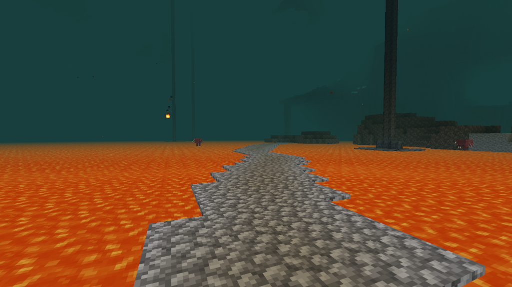

# Lava Walker

A Fabric mod that adds the **Lava Walker** enchantment.

## Features

**Lava Walker** works like Frost Walker, but for lava - walk across lava lakes by turning lava source blocks into cobblestone beneath your feet.

- Enchantment for boots, one level only
- Converts lava source blocks to cobblestone when walking nearby
- Small 2-block radius for balance
- Cobblestone is permanent (unlike Frost Walker's ice)
- From the enchanting table, loot and librarian trades
- Mutually exclusive with Frost Walker and Depth Strider

## Getting One

The enchanting table offers it on boots, among everything else it might offer, and it also comes out of chests, off fishing rods and now and then from a librarian's ordinary book trades. None of those is a plan.

So with [village-quests](https://github.com/fatlard1993/village-quests) installed, a librarian who trusts you a great deal (60 reputation) will sell the one book they do not put on the shelf, for 32 emeralds.

## Screenshot

## Pandorical

Lava Walker runs server-side, and Pandorical is required: the server will not load this mod without it. It syncs the enchantment's translations through Pandorical's content sync, and that is the whole of its Pandorical usage.

Clients are the optional half, and the stake is only the name. A player on a Pandorical client sees "Lava Walker"; a player on a vanilla client sees the raw translation key. The enchantment works identically either way.

## Development

Installing is in [DEVELOPMENT.md](DEVELOPMENT.md).

## License

MIT, see [LICENSE](LICENSE).
